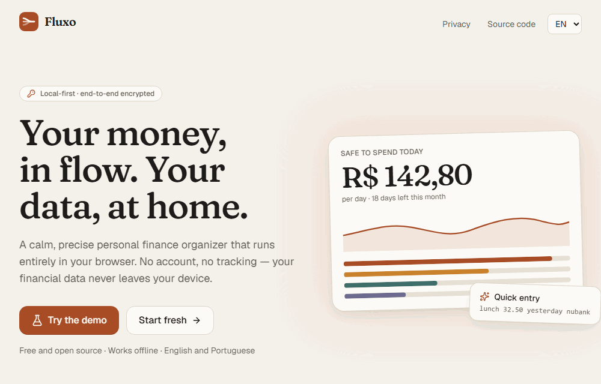
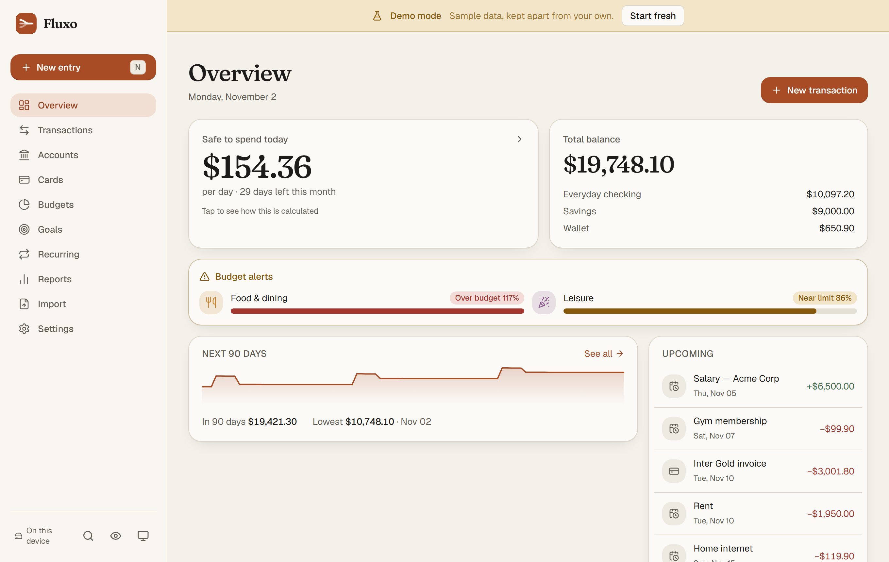
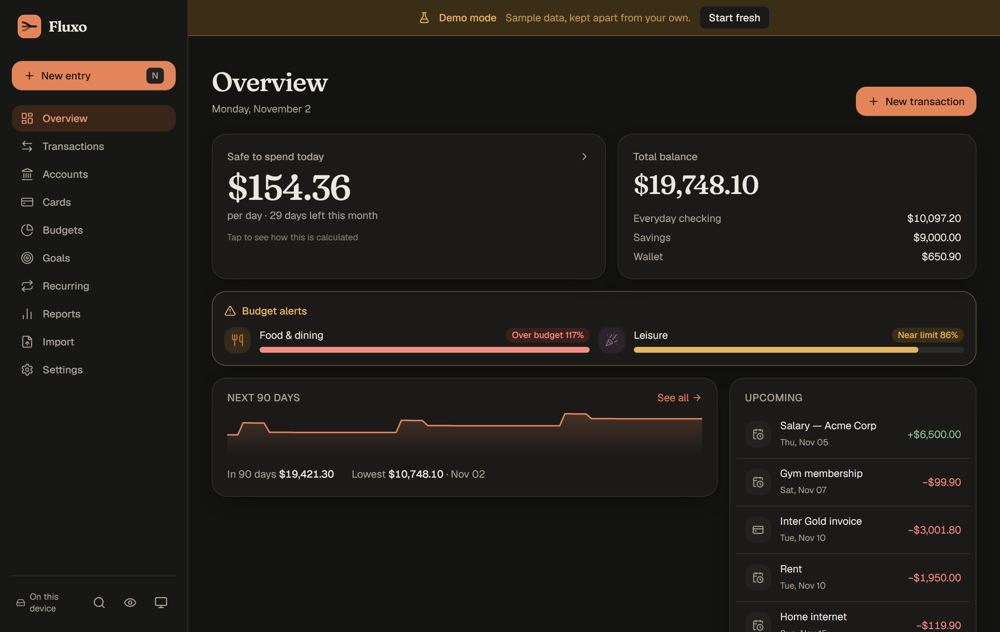
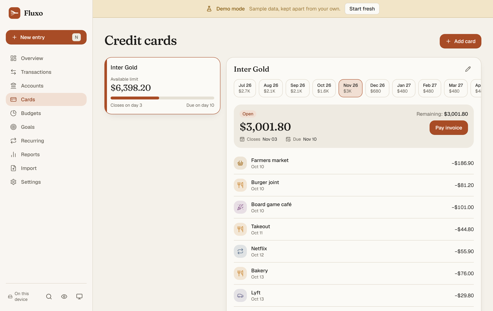
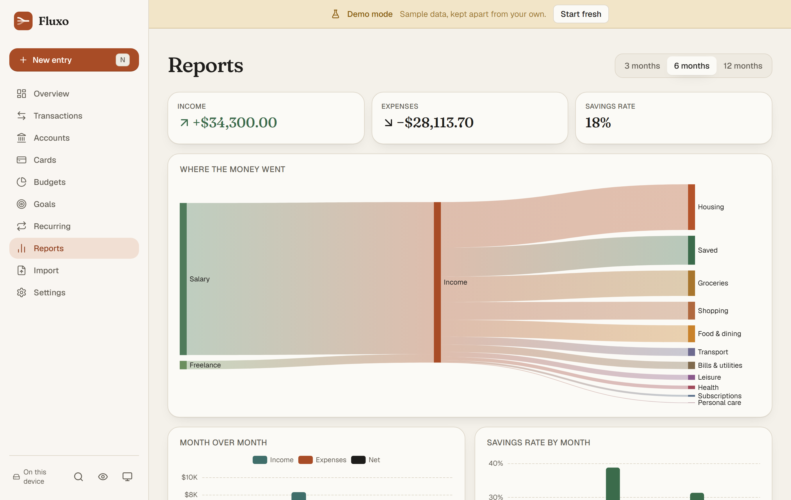
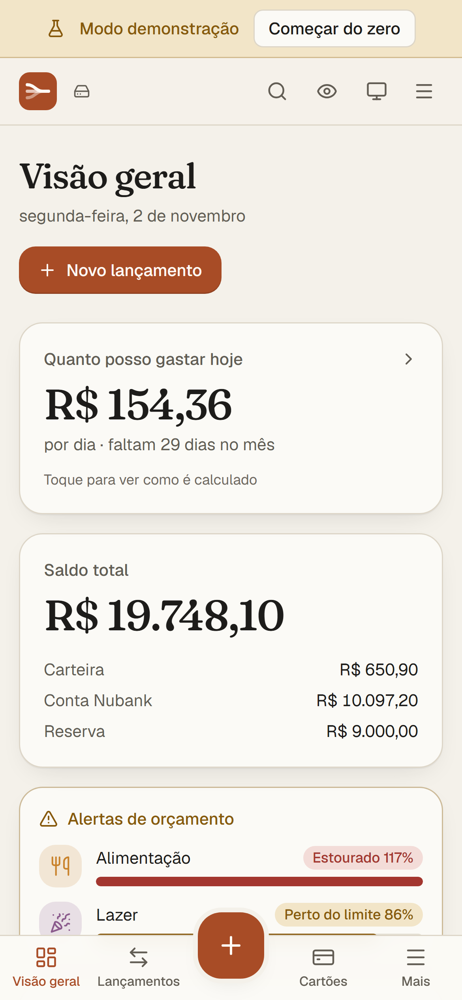
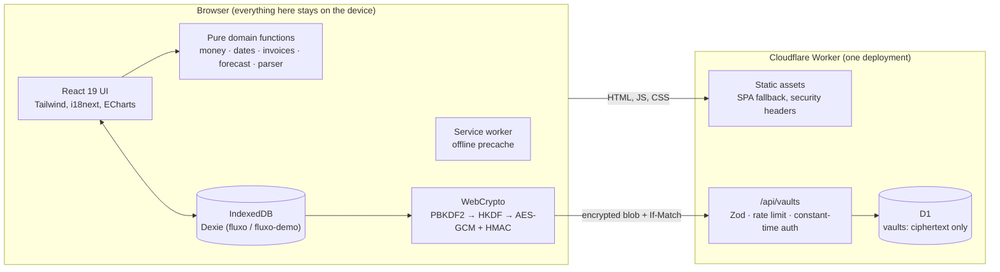

# Fluxo

**Local-first personal finance. Your financial data never leaves your device.**

Fluxo is a calm, precise money organizer that runs entirely in the browser. There is no
account and no login: everything lives in IndexedDB on your device and works offline. If you
want your data on more than one device, Fluxo syncs it through a vault that is **encrypted end
to end** — the server only ever stores bytes it cannot read.

[Português](README.pt-BR.md) · [Security model](SECURITY.md)



| Overview (light)                                         | Overview (dark)                                        |
| -------------------------------------------------------- | ------------------------------------------------------ |
|  |  |

| Credit cards                                  | Reports                                                  | Mobile                                                 |
| --------------------------------------------- | -------------------------------------------------------- | ------------------------------------------------------ |
|  |  |  |

## Features

- **Credit cards, the Brazilian way** — closing and due days (short months handled), purchases
  on the closing day go to the next invoice, installments split in cents with the rounding
  difference on the first one, each installment on the right invoice, computed invoice
  statuses (open, closed, paid, future), partial payments and the available limit net of
  future installments.
- **Safe to spend today** — checking and wallet balances, minus recurring bills and card
  invoices still due this month, minus planned goal contributions, divided by the days left.
  Never shows a negative "spendable" amount; a deficit is shown as an alert, and the full
  calculation is one tap away.
- **90-day forecast** — daily projected balance from recurrences, future installments and
  invoice due dates, with negative stretches highlighted, plus a calendar of bills and income.
- **Quick entry in plain language (PT and EN)** — `almoço 32,50 ontem nubank`,
  `tênis 600 em 3x cartão inter`, `aluguel 1800 todo dia 5`, `coffee 12.90 yesterday`.
  Rule-based and fully local (no AI), with an editable preview before saving.
- **Statement import that learns** — OFX (SGML and XML) and CSV with column mapping,
  delimiter and Brazilian number format detection, duplicate detection (FITID, or date +
  amount + normalized description). Fix a category once and a rule is learned for the next
  imports and quick entries.
- **Budgets and goals** — monthly limits per category with 80%/100% alerts and rollover;
  goals with a target, planned monthly contribution and an ETA based on the actual pace.
- **Reports** — Sankey from income to expense categories, month over month, savings rate and
  category trends (ECharts, loaded on demand).
- **Optional end-to-end encrypted sync** — create a vault or join one with a link or QR code
  plus your passphrase.
- **Demo mode** — six months of deterministic sample data in a separate database.
- **Details** — privacy mode (`P`) blurs every amount, light/dark/auto themes, command
  palette (`Ctrl/⌘+K`), shortcuts (`N`, `/`, `P`, `?`), installable PWA with offline support
  and update prompt, JSON backup/restore, CSV export, English and Brazilian Portuguese,
  keyboard navigation, visible focus, AA contrast and `prefers-reduced-motion`.

## Architecture



One Cloudflare Worker serves the built site and the `/api/*` routes (`run_worker_first` only
for the API, SPA fallback for everything else). The API exists only for sync.

## Sync security model

| The server sees                                               | The server never sees                              |
| ------------------------------------------------------------- | -------------------------------------------------- |
| A random vault ID (128 bits)                                  | Your passphrase                                    |
| The PBKDF2 salt (not secret by design)                        | The encryption key or the auth key                 |
| SHA-256 of the access token                                   | The access token itself                            |
| One encrypted blob, its size, a version number and timestamps | Any account, transaction, amount, name or category |
| Request IPs (for rate limiting)                               | How many records you have or what changed          |

- The passphrase goes through **PBKDF2-SHA-256 with 600,000 iterations**; **HKDF** derives two
  independent keys from the result: `encKey` (AES-GCM 256) and `authKey` (HMAC-SHA-256). Both
  are non-extractable `CryptoKey`s.
- `authToken = HMAC(authKey, vaultId)`. The server stores only its SHA-256 and compares in
  constant time, so knowing a vault ID is not enough to read or overwrite it.
- Each upload is a gzip-compressed JSON snapshot (tombstones included) sealed with AES-GCM
  using a fresh 12-byte IV and the vault ID as additional authenticated data.
- Merging is per record — the newest `updatedAt` wins and deletions propagate as tombstones.
  Writes use `If-Match`; a `409` restarts the cycle on top of the newer version.
- Pairing links carry the vault ID and salt after `#`, which browsers never send to servers.
- Losing the passphrase means losing the synced copy. Nobody can recover it.

See [SECURITY.md](SECURITY.md) for the full threat model.

## Tech stack

- **Front end:** React 19, Vite, TypeScript (`strict`), Tailwind CSS v4, React Router, Dexie +
  dexie-react-hooks, Zustand (UI state only), Zod, ECharts, i18next, vite-plugin-pwa, sonner,
  lucide-react. Fonts: Fraunces and Geist, self-hosted.
- **Back end:** a single Cloudflare Worker with static assets and a D1 database.
- **Quality:** Vitest, `@cloudflare/vitest-plugin` for Worker tests, Playwright, ESLint,
  Prettier, `tsc --noEmit`, GitHub Actions.

## Running locally

Requires **Node 22 LTS** (see `.nvmrc`).

```bash
npm ci
npm run dev            # the app at http://localhost:5173
```

Sync needs the Worker and a local D1 database:

```bash
npx wrangler d1 migrations apply fluxo --local
npm run build && npm run worker:dev   # Worker + API at http://localhost:8787
```

The Vite dev server proxies `/api` to `localhost:8787`, so `npm run dev` and
`npm run worker:dev` can run side by side.

## Tests

```bash
npm run lint
npm run typecheck
npm test               # unit tests (domain, parser, import, crypto, merge, i18n…)
npm run test:worker    # Worker API tests inside the Workers runtime (needs a build in dist/)
npm run test:e2e       # Playwright smoke test on desktop and mobile
```

CI runs all of the above plus `wrangler deploy --dry-run` on every push and pull request.
`npx tsx scripts/capture-media.ts` regenerates the screenshots and GIF from the demo, and
`npx tsx scripts/generate-assets.ts` regenerates icons and the Open Graph image.

## Technical decisions

- **Money is integer cents.** Every amount is `amountCents: number`. Parsing works on the
  digits of the string, splitting uses integer division with the remainder on the first
  installment, and `Intl.NumberFormat` formats only for display (BRL by default; the currency
  can be changed).
- **Dates are local calendar days.** Transactions use `'YYYY-MM-DD'` and months `'YYYY-MM'`.
  Nothing goes through UTC `Date` objects; arithmetic is on numeric parts in one tested module,
  so a purchase at 23:30 never moves to the next day and DST cannot shift a date.
- **Local-first.** IndexedDB is the source of truth. Every record has a UUID v7 `id`,
  `createdAt`, `updatedAt` and `deletedAt` (soft delete), which makes offline edits and sync
  merges straightforward. The Dexie schema is versioned with migrations, and JSON backups
  carry a `schemaVersion` and are validated with Zod before anything is written.
- **Pure domain logic.** Invoices, installments, recurrences, forecast, safe-to-spend,
  budgets, goals, the parser, importers and the merge are plain functions with no React,
  which keeps them easy to test.
- **Lazy where it is heavy.** Charts, statement parsers, sync crypto, dialogs and the data
  layer load on demand; the landing page ships without the database code.

## License

[MIT](LICENSE) © Luciano Pereira
