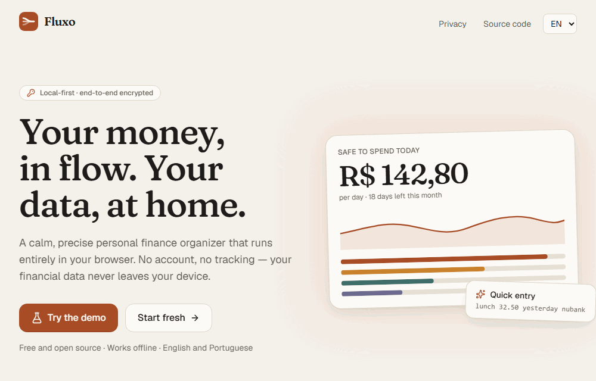
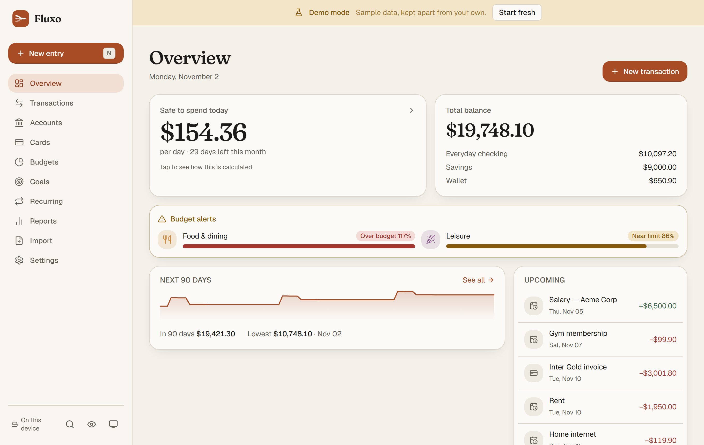
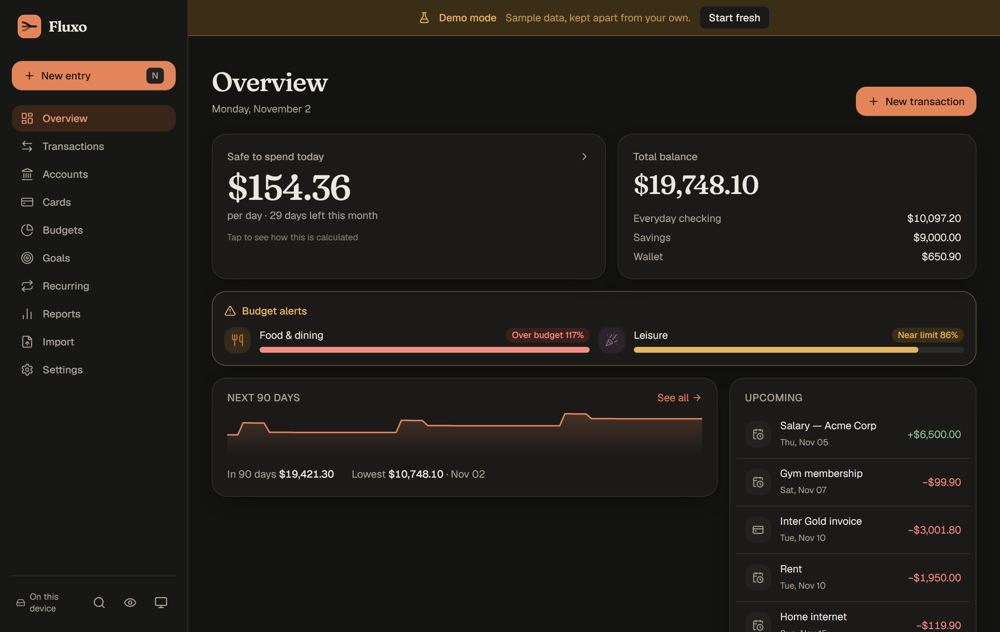
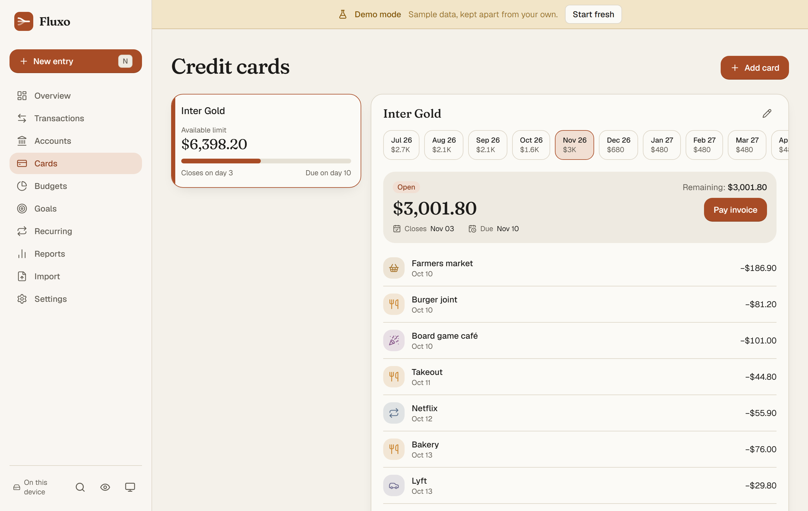
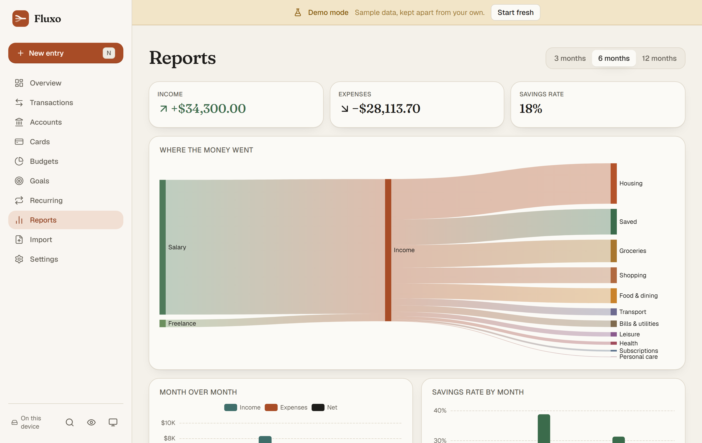
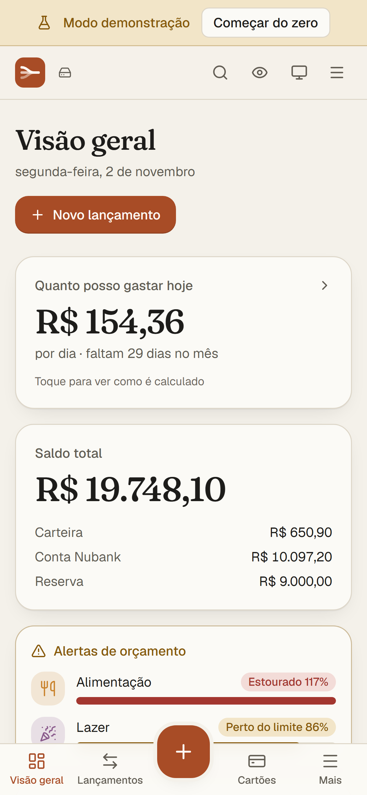
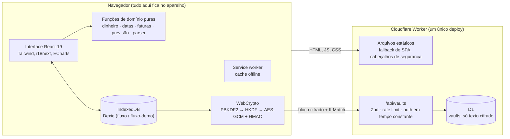

# Fluxo

**Finanças pessoais local-first. Seus dados financeiros nunca saem do seu aparelho.**

O Fluxo é um organizador de dinheiro calmo e preciso que roda inteiro no navegador. Não há
conta nem login: tudo fica no IndexedDB do seu aparelho e funciona offline. Se você quiser os
dados em mais de um aparelho, o Fluxo sincroniza por um cofre **criptografado de ponta a
ponta** — o servidor só guarda bytes que ele não consegue ler.

[English](README.md) · [Modelo de segurança](SECURITY.md) · [Guia de deploy](DEPLOY.md)



| Visão geral (claro)                                         | Visão geral (escuro)                                        |
| ----------------------------------------------------------- | ----------------------------------------------------------- |
|  |  |

| Cartões                                    | Relatórios                                                | Celular                                                   |
| ------------------------------------------ | --------------------------------------------------------- | --------------------------------------------------------- |
|  |  |  |

## Funcionalidades

- **Cartão de crédito do jeito brasileiro** — dia de fechamento e de vencimento (com ajuste em
  meses curtos), compra no dia do fechamento vai para a fatura seguinte, parcelas divididas em
  centavos com a diferença do arredondamento na primeira, cada parcela na fatura certa, status
  da fatura calculado (aberta, fechada, paga, futura), pagamento parcial e limite disponível
  descontando as parcelas futuras.
- **Quanto posso gastar hoje** — saldo das contas correntes e carteira, menos as contas
  recorrentes e faturas que ainda vencem no mês, menos os aportes planejados das metas,
  dividido pelos dias restantes. Nunca mostra valor negativo como "pode gastar": o déficit
  aparece como alerta, e a conta completa fica a um toque.
- **Previsão de 90 dias** — saldo diário projetado com recorrências, parcelas futuras e
  vencimentos de fatura, com os trechos negativos destacados, e um calendário de contas a pagar
  e a receber.
- **Lançamento rápido em linguagem natural (PT e EN)** — `almoço 32,50 ontem nubank`,
  `tênis 600 em 3x cartão inter`, `aluguel 1800 todo dia 5`, `coffee 12.90 yesterday`.
  Por regras, 100% local (sem IA), com prévia editável antes de salvar.
- **Importação de extrato que aprende** — OFX (SGML e XML) e CSV com mapeamento de colunas,
  detecção de separador e de formato de número brasileiro, detecção de duplicatas (FITID, ou
  data + valor + descrição normalizada). Corrija uma categoria uma vez e uma regra é aprendida
  para as próximas importações e lançamentos rápidos.
- **Orçamentos e metas** — limite mensal por categoria com alertas em 80% e 100% e sobra
  transportada; metas com valor-alvo, aporte mensal planejado e previsão de data pelo ritmo real.
- **Relatórios** — Sankey das receitas para as categorias de despesa, mês a mês, taxa de
  poupança e tendência por categoria (ECharts, carregado sob demanda).
- **Sincronização opcional criptografada de ponta a ponta** — crie um cofre ou entre num com
  um link ou QR code e a sua frase-senha.
- **Modo demonstração** — seis meses de dados fictícios determinísticos, num banco separado.
- **Detalhes** — modo privacidade (`P`) borra todos os valores, tema claro/escuro/automático,
  paleta de comandos (`Ctrl/⌘+K`), atalhos (`N`, `/`, `P`, `?`), PWA instalável com suporte
  offline e aviso de nova versão, backup/restauração em JSON, exportação em CSV, inglês e
  português do Brasil, navegação por teclado, foco visível, contraste AA e
  `prefers-reduced-motion`.

## Arquitetura



Um único Cloudflare Worker serve o site compilado e as rotas `/api/*` (`run_worker_first` só
para a API, fallback de SPA para o resto). A API existe apenas para a sincronização.

## Modelo de segurança da sincronização

| O servidor vê                                            | O servidor nunca vê                                  |
| -------------------------------------------------------- | ---------------------------------------------------- |
| Um ID de cofre aleatório (128 bits)                      | A sua frase-senha                                    |
| O salt do PBKDF2 (não é secreto, por definição)          | A chave de cifragem ou a de autenticação             |
| O SHA-256 do token de acesso                             | O próprio token                                      |
| Um bloco cifrado, o tamanho, um número de versão e datas | Qualquer conta, lançamento, valor, nome ou categoria |
| IPs das requisições (para o rate limit)                  | Quantos registros você tem ou o que mudou            |

- A frase-senha passa por **PBKDF2-SHA-256 com 600.000 iterações**; o **HKDF** deriva do
  resultado duas chaves independentes: `encKey` (AES-GCM 256) e `authKey` (HMAC-SHA-256).
  As duas são `CryptoKey` não exportáveis.
- `authToken = HMAC(authKey, vaultId)`. O servidor guarda só o SHA-256 dele e compara em tempo
  constante, então saber o ID do cofre não basta para ler ou sobrescrever.
- Cada envio é um retrato JSON comprimido com gzip (incluindo os tombstones), selado com
  AES-GCM usando um IV novo de 12 bytes e o ID do cofre como dado autenticado adicional.
- A mesclagem é por registro — vence o `updatedAt` mais recente e as exclusões se propagam
  como tombstones. As gravações usam `If-Match`; um `409` refaz o ciclo sobre a versão nova.
- Os links de pareamento levam o ID do cofre e o salt depois do `#`, que os navegadores nunca
  enviam ao servidor.
- Perder a frase-senha significa perder a cópia sincronizada. Ninguém consegue recuperá-la.

Veja o [SECURITY.md](SECURITY.md) para o modelo de ameaça completo.

## Stack

- **Front-end:** React 19, Vite, TypeScript (`strict`), Tailwind CSS v4, React Router, Dexie +
  dexie-react-hooks, Zustand (só estado de interface), Zod, ECharts, i18next, vite-plugin-pwa,
  sonner, lucide-react. Fontes: Fraunces e Geist, hospedadas no próprio app.
- **Back-end:** um único Cloudflare Worker com arquivos estáticos e um banco D1.
- **Qualidade:** Vitest, `@cloudflare/vitest-plugin` para os testes do Worker, Playwright,
  ESLint, Prettier, `tsc --noEmit`, GitHub Actions.

## Rodando localmente

Requer **Node 22 LTS** (veja o `.nvmrc`).

```bash
npm ci
npm run dev            # o app em http://localhost:5173
```

A sincronização precisa do Worker e de um D1 local:

```bash
npx wrangler d1 migrations apply fluxo --local
npm run build && npm run worker:dev   # Worker + API em http://localhost:8787
```

O servidor de desenvolvimento do Vite encaminha `/api` para `localhost:8787`, então
`npm run dev` e `npm run worker:dev` podem rodar juntos.

## Testes

```bash
npm run lint
npm run typecheck
npm test               # testes unitários (domínio, parser, importação, cripto, mesclagem, i18n…)
npm run test:worker    # testes da API do Worker no runtime de Workers (precisa do build em dist/)
npm run test:e2e       # teste de fumaça Playwright no desktop e no celular
```

O CI roda tudo isso e mais o `wrangler deploy --dry-run` a cada push e pull request.
`npx tsx scripts/capture-media.ts` gera de novo os prints e o GIF a partir do demo, e
`npx tsx scripts/generate-assets.ts` gera de novo os ícones e a imagem Open Graph.

## Decisões técnicas

- **Dinheiro em centavos inteiros.** Todo valor é `amountCents: number`. A leitura trabalha
  sobre os dígitos do texto, a divisão de parcelas usa divisão inteira com o resto na primeira
  parcela, e o `Intl.NumberFormat` só formata para exibição (BRL por padrão; a moeda pode ser
  trocada).
- **Datas como dia de calendário local.** Lançamentos usam `'YYYY-MM-DD'` e meses `'YYYY-MM'`.
  Nada passa por `Date` em UTC; a aritmética é feita sobre as partes numéricas num módulo
  testado, então uma compra às 23h30 nunca vai para o dia seguinte e o horário de verão não
  desloca datas.
- **Local-first.** O IndexedDB é a fonte da verdade. Todo registro tem `id` UUID v7,
  `createdAt`, `updatedAt` e `deletedAt` (exclusão lógica), o que simplifica edições offline e a
  mesclagem da sincronização. O esquema Dexie tem versões e migrações, e o backup JSON tem
  `schemaVersion` e é validado com Zod antes de gravar qualquer coisa.
- **Domínio em funções puras.** Faturas, parcelas, recorrências, previsão, safe-to-spend,
  orçamentos, metas, o parser, os leitores de extrato e a mesclagem são funções sem React,
  fáceis de testar.
- **Carregamento sob demanda onde pesa.** Gráficos, leitores de extrato, criptografia da
  sincronização, janelas e a camada de dados carregam quando necessários; a landing page não
  leva o código do banco.

## Licença

[MIT](LICENSE) © Luciano Pereira
